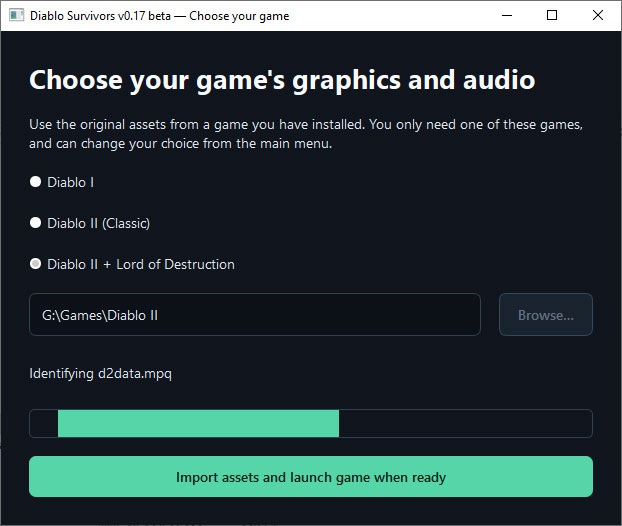
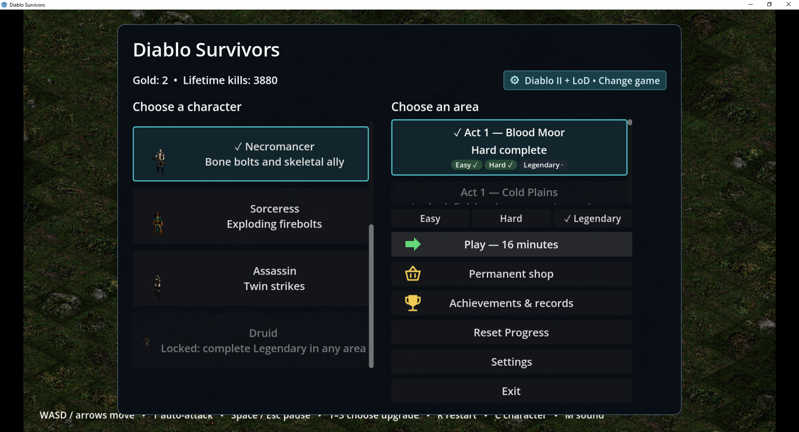
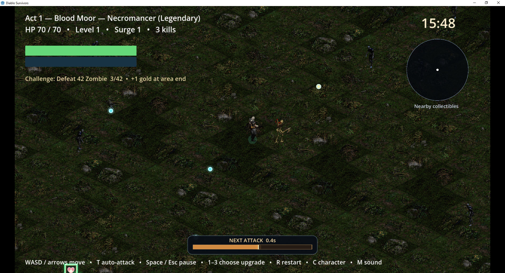
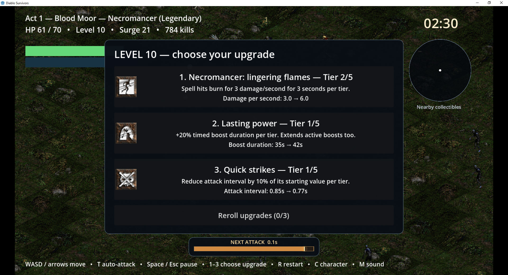
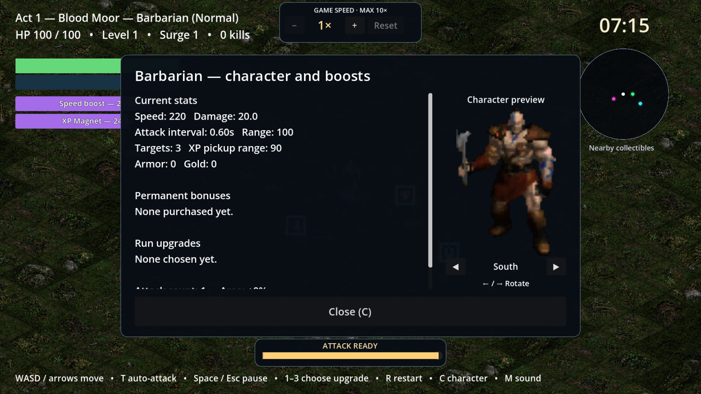

# Diablo Survivors

**v0.23 beta · Windows 10 64-bit**

Diablo Survivors is a survival action game inspired by Vampire Survivors, using graphics and audio from your own installation of Diablo I, classic Diablo II, or Diablo II with Lord of Destruction. Choose a character, survive waves of enemies, collect experience, and build a powerful combination of upgrades before the timer runs out.

[Watch gameplay footage](video/demo.mp4)

**Diablo II compatibility:** Diablo II and Diablo II: Lord of Destruction work with the original CD versions. Battle.net versions have not been tested and may not work.

## Screenshots

## Download Latest Version

Download both parts of **v0.23 beta** into the same folder:

- [Part 1 (EXE)](Diablo_Survivors_v0.23_beta_Windows_x64_Setup.part1.exe)
- [Part 2 (RAR)](Diablo_Survivors_v0.23_beta_Windows_x64_Setup.part2.rar)

Run **Diablo_Survivors_v0.23_beta_Windows_x64_Setup.part1.exe** and choose an extraction folder. The second part is read automatically; WinRAR is not required. After extraction, open the **Diablo Survivors** folder and run **Diablo Survivors.exe** when ready. The extractor does not launch the game. Keep the complete game folder together in a writable location.

**First-time setup can take a few minutes** while the game imports your selected installation's assets and builds its local asset cache. Let the import finish; subsequent launches reuse the cache.

Please note that updates may require re-building the asset cache.

## What's new in v0.23 beta

- **Magic particles:** yellow/orange sparks around Firebolt and Firestorm; white/aqua sparks around Bone Spear.
- **Spell visual fixes:** Bone Spear no longer has a black halo; spell tips point along their exact flight direction, including diagonal shots.

- **Shorter default range:** player and enemy ranged attack distances are halved.
- **Meaningful Long reach:** projectiles now stop at the attack-distance limit, and each tier increases both targeting and travel by 10%.

## What's new in v0.22 beta

- **Original caster spells:** Sorcerer/Sorceress cast Firebolt, Necromancer casts piercing Bone Spear, and Druid casts spreading Firestorm with lingering ground flames.
- **Casting timing:** spells release during the casting gesture; Bone Spear has no fire splash. Paladin remains melee.

## What's new in v0.21 beta

- **Asset-cache handoff:** the game executable can recover the selected imported asset cache when opened directly, instead of silently loading the default graphics.
- **Launch diagnostics:** startup failures remain visible in the launcher, with logs in `.local/logs` for troubleshooting different system setups.
- **Character sprite preview:** the character window shows your character in the right column. Use the left/right arrow keys or the on-screen arrows to rotate through eight directions.
- **Cohesive D2 terrain:** continuous outdoor ground with original trees, palms, cacti, and rocks instead of mixed transition tiles.
- **D2 direction fixes:** corrected sprite direction lookup for movement and attacks, with refreshed cached animations.

## What's new in v0.19 beta

- **Gameplay speed control:** centered at the top of the screen, with 1×, 1.5×, 2×, 3×, 5×, and 10× settings..
- **Windows download fix:** the distribution ZIP now includes Python's required standard-library archive, fixing the missing encodings startup error.

## Choose your Diablo

| Game | Playable classes | Enemy profiles | Survival areas |
| --- | ---: | ---: | ---: |
| Diablo I | 3 | 95 | 22 |
| Diablo II | 5 | 236 | 101 |
| Diablo II + Lord of Destruction | 7 | 309 | 124 |

Diablo I offers the **Warrior, Rogue, and Sorcerer**. Diablo II offers the **Barbarian, Amazon, Paladin, Necromancer, and Sorceress**, with **Assassin and Druid** available through Lord of Destruction. Start with Warrior or Barbarian and unlock more characters through play.

Enemy profiles include variants, bosses, and named uniques. D2 uses its own Acts and area progression, with original regional graphics in survival layouts. Classes and enemy behavior are adapted for survival gameplay rather than reproducing the original games' complete skill systems.

Only one supported game installation is needed. Diablo II: Resurrected / Infernal Edition is not supported.

## Survive and progress

- **Three difficulties per area:** Normal lasts 8 minutes, Nightmare lasts 12, and Hell lasts 16.
- **Sequential unlocks:** clear Normal to unlock Nightmare, then Nightmare to unlock Hell. A Hell clear unlocks and selects the next area.
- **Enemy surges:** melee enemies, ranged attackers, and elites arrive in increasingly demanding surges with recovery periods.
- **Area-specific enemies and challenges:** complete progressively harder objectives to earn gold. Each challenge pays its gold reward only once.
- **Saved progression:** character unlocks, area clears, permanent upgrades, achievements, and records persist between sessions.
- **Replayable areas:** return to unlocked areas and difficulties to finish challenges and improve your records.

## Build your character

- **Tiered run upgrades:** improve weapon damage, attack speed, critical hits, health, defense, regeneration, movement, and more. Fully upgraded options leave the selection pool.
- **Projectile builds:** add piercing and multishot, increase projectile speed, or expand spell splash and attack area.
- **Minions:** summon glowing wisps or skeletal allies when playing the Necromancer.
- **Upgrade rerolls:** start with three per run; buy up to five additional permanent rerolls for a maximum of eight.
- **Permanent gold shop:** General, Defense, and Class upgrades have increasing rank costs. Class options match the selected game and available characters.
- **Increasing XP requirements:** later levels require progressively more experience.

## Explore and collect

- **Glowing pickups:** collect healing, speed boosts, XP magnets, and rare Orb Harvest boosts that draw experience orbs from across the map.
- **Timed boost bars:** see active bonuses and their remaining duration; duration upgrades extend their effects.
- **Nearby collectible minimap:** locate pickups and track the treasure goblin's yellow star.
- **Rare treasure goblins:** chase a fleeing goblin using its fading golden particle trail, hear its arrival announcement, and earn treasure by defeating it.
- **Rare cow portals:** enter an eight-minute cow challenge and defeat at least 500 cows before time expires to earn its bonus reward.

## Combat and presentation

- **Automatic or manual attacks:** toggle auto-attack with T, then use left-click to attack toward the cursor when it is off.
- **Attack cooldown display:** see when the next attack is ready while moving between attacks.
- **Damage variation and critical hits:** floating damage numbers distinguish critical strikes.
- **Impact feedback:** enemies flash red and shake briefly when hit, with randomized impact audio and varied enemy death sounds.
- **Original animation and sound:** characters and enemies use imported sprites, attacks, death sequences, and game audio.
- **Magical effects:** glowing projectile particles, pickup motes, boost effects, and pulsing minions add visual feedback.
- **Music and sound controls:** toggle music, adjust music and SFX volumes, and enable or disable damage screen shake.
- **End-of-run rewards:** see kills, collected experience, completed challenges, and gold earned.
- **Achievements and records:** track milestones and repeat challenge completions for bragging rights.

